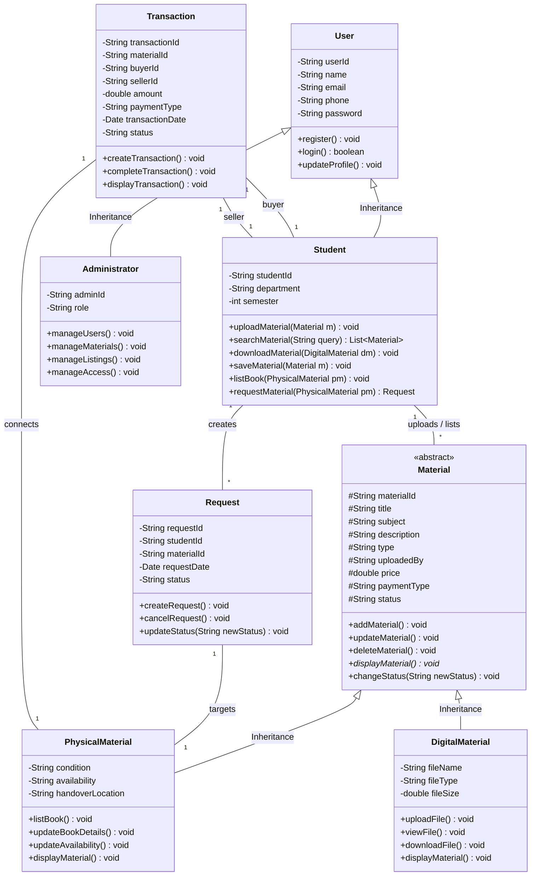

# Mini Project Design Document
## PBCST304 - Object-Oriented Programming
### Department of Computer Science

---

# Project Title: BookBridge
### Academic Resource Sharing & Peer-to-Peer Physical Book Exchange Platform

**Course Code:** PBCST304 - Object-Oriented Programming  
**Team Member 1:** UI/UX Design, HTML Architecture, CSS Styling  
**Platform Stack:** Java, Spring Boot, MySQL, HTML5, CSS3, JavaScript  

---

## 1. Problem Definition

College students frequently encounter challenges when trying to access curriculum-aligned academic resources:
1. **Scattered Digital Materials:** Lecture notes, syllabus references, assignments, and previous years' question papers (PYQs) are dispersed across disparate personal drives, messaging apps, and unofficial groups, causing loss of critical study resources.
2. **Underutilized Physical Textbooks:** Students often have expensive, high-quality textbooks from earlier semesters sitting idle on their shelves, while junior students are forced to purchase brand-new books at full retail price.
3. **Absence of a Dedicated Campus Platform:** Existing generic e-commerce sites or social media classifieds lack academic categorization (semester, branch, course codes) and involve unnecessary shipping costs or third-party payment cuts.

**BookBridge** solves this problem by providing a centralized web-based platform tailored for the campus community. It enables students to freely share and download digital study packs and list used physical textbooks for affordable direct cash handover on campus grounds.

---

## 2. Objectives

- **Centralized Academic Hub:** To create a unified portal for discovering course notes, lab manuals, and question papers organized by department and semester.
- **Peer-to-Peer Campus Marketplace:** To allow students to buy and sell physical academic textbooks directly with cash payment upon personal verification.
- **Strict OOP Implementation:** To design a clean, extensible domain model implementing all four pillars of Object-Oriented Programming (Encapsulation, Inheritance, Polymorphism, Abstraction) in Java.
- **Dual-Resource Architecture:** To support both digital files (view, download, preview) and physical books (condition grading, cash handover coordination).
- **Administrative Governance:** To equip platform administrators with monitoring, moderation, and moderation controls to preserve academic integrity.

---

## 3. System Architecture & Class Diagram

### 3.1 Class Relationship Diagram (UML)



---

## 4. Detailed Description of Each Class

### 4.1 Class: `User` (Base Parent Class)
- **Role:** Represents any individual authenticated on the platform.
- **Attributes:**
  - `userId` (`String`): Unique identifier for the account.
  - `name` (`String`): Full name of the user.
  - `email` (`String`): Registered college email address.
  - `phone` (`String`): Contact phone/WhatsApp number.
  - `password` (`String`): Securely hashed password.
- **Methods:**
  - `register()`: Inserts a new user record.
  - `login()`: Authenticates user credentials.
  - `updateProfile()`: Updates phone number and contact preferences.

### 4.2 Class: `Student` (Inherits from `User`)
- **Role:** Handles student-specific interactions (both as buyer/downloader and uploader/seller).
- **Attributes:**
  - `studentId` (`String`): College roll/registration number (e.g. `2024CS041`).
  - `department` (`String`): Branch of study (CSE, IT, ECE, MECH, etc.).
  - `semester` (`int`): Current academic semester (1–8).
- **Methods:**
  - `uploadMaterial()`: Uploads lecture notes or question papers.
  - `listBook()`: Adds a physical used textbook listing.
  - `requestMaterial()`: Submits a purchase request for a peer's book.
  - `downloadMaterial()`: Initiates local download of digital materials.

### 4.3 Class: `Administrator` (Inherits from `User`)
- **Role:** Oversees system operation, community standards, and user moderation.
- **Attributes:**
  - `adminId` (`String`): Unique administrator reference code.
  - `role` (`String`): Role level (`SUPER_ADMIN`, `MODERATOR`).
- **Methods:**
  - `manageUsers()`: Reviews and suspends fraudulent student accounts.
  - `manageMaterials()`: Approves or flags reported study notes.
  - `manageListings()`: Removes duplicate or spam book listings.

### 4.4 Class: `Material` (Abstract Base Class)
- **Role:** Defines common state and behaviors shared across all resources.
- **Attributes:**
  - `materialId` (`String`), `title` (`String`), `subject` (`String`), `description` (`String`), `type` (`String`), `uploadedBy` (`String`), `price` (`double`), `paymentType` (`String`), `status` (`String`).
- **Key OOP Concept:** Abstract class declaring an abstract method `displayMaterial()` implemented polymorphically by child classes.

### 4.5 Class: `DigitalMaterial` (Inherits from `Material`)
- **Role:** Digital study files (PDF, DOCX).
- **Attributes:**
  - `fileName`, `fileType`, `fileSize`.
- **Methods:**
  - `uploadFile()`, `viewFile()`, `downloadFile()`, `displayMaterial()`.

### 4.6 Class: `PhysicalMaterial` (Inherits from `Material`)
- **Role:** Tangible textbooks available for campus cash exchange.
- **Attributes:**
  - `condition` (`New`, `Like New`, `Good`, `Fair`), `availability` (`Available`, `Pending`, `Sold`), `handoverLocation`.
- **Methods:**
  - `listBook()`, `updateBookDetails()`, `updateAvailability()`, `displayMaterial()`.

### 4.7 Class: `Request`
- **Role:** Manages the lifecycle of a student's inquiry to buy a physical book.
- **Attributes:**
  - `requestId`, `studentId` (Buyer), `materialId`, `requestDate`, `status` (`PENDING`, `ACCEPTED`, `COMPLETED`, `CANCELLED`).
- **Methods:**
  - `createRequest()`, `cancelRequest()`, `updateStatus()`.

### 4.8 Class: `Transaction`
- **Role:** Audits completed and in-progress handovers between students.
- **Attributes:**
  - `transactionId`, `materialId`, `buyerId`, `sellerId`, `amount`, `paymentType` (`CASH_ON_HANDOVER`), `transactionDate`, `status`.

---

## 5. Object-Oriented Principles Applied

1. **Encapsulation:**  
   All attributes across classes are declared `private` or `protected`. State is manipulated solely through getters, setters, and business logic methods.
2. **Inheritance:**  
   - `Student` and `Administrator` extend `User`.  
   - `DigitalMaterial` and `PhysicalMaterial` extend `Material`.
3. **Polymorphism:**  
   The abstract method `displayMaterial()` in `Material` is overridden in `DigitalMaterial` (rendering file metadata and download buttons) and `PhysicalMaterial` (rendering book condition and handover request buttons).
4. **Abstraction:**  
   Complex database operations and status workflows are abstracted behind clean interfaces (`createRequest()`, `downloadFile()`).

---

## 6. Data Storage Design (MySQL)

```sql
-- 1. User Table (Base)
CREATE TABLE users (
    user_id VARCHAR(50) PRIMARY KEY,
    name VARCHAR(100) NOT NULL,
    email VARCHAR(100) UNIQUE NOT NULL,
    phone VARCHAR(20),
    password VARCHAR(255) NOT NULL,
    user_type ENUM('STUDENT', 'ADMIN') NOT NULL
);

-- 2. Student Table
CREATE TABLE students (
    student_id VARCHAR(50) PRIMARY KEY,
    user_id VARCHAR(50) NOT NULL,
    department VARCHAR(50) NOT NULL,
    semester INT NOT NULL,
    FOREIGN KEY (user_id) REFERENCES users(user_id) ON DELETE CASCADE
);

-- 3. Material Table (Common)
CREATE TABLE materials (
    material_id VARCHAR(50) PRIMARY KEY,
    title VARCHAR(200) NOT NULL,
    subject VARCHAR(100) NOT NULL,
    description TEXT,
    material_type ENUM('DIGITAL', 'PHYSICAL') NOT NULL,
    uploaded_by VARCHAR(50) NOT NULL,
    price DECIMAL(8,2) DEFAULT 0.00,
    payment_type VARCHAR(50) DEFAULT 'FREE',
    status VARCHAR(30) DEFAULT 'AVAILABLE',
    created_at TIMESTAMP DEFAULT CURRENT_TIMESTAMP,
    FOREIGN KEY (uploaded_by) REFERENCES users(user_id)
);

-- 4. Digital Material Specifics
CREATE TABLE digital_materials (
    material_id VARCHAR(50) PRIMARY KEY,
    file_name VARCHAR(255) NOT NULL,
    file_type VARCHAR(50),
    file_size_mb DECIMAL(6,2),
    FOREIGN KEY (material_id) REFERENCES materials(material_id) ON DELETE CASCADE
);

-- 5. Physical Book Specifics
CREATE TABLE physical_materials (
    material_id VARCHAR(50) PRIMARY KEY,
    author VARCHAR(100),
    isbn VARCHAR(30),
    book_condition ENUM('NEW', 'LIKE_NEW', 'GOOD', 'FAIR') NOT NULL,
    handover_location VARCHAR(150),
    FOREIGN KEY (material_id) REFERENCES materials(material_id) ON DELETE CASCADE
);

-- 6. Handover Request Table
CREATE TABLE requests (
    request_id VARCHAR(50) PRIMARY KEY,
    buyer_id VARCHAR(50) NOT NULL,
    material_id VARCHAR(50) NOT NULL,
    request_date TIMESTAMP DEFAULT CURRENT_TIMESTAMP,
    proposed_location VARCHAR(150),
    message TEXT,
    status ENUM('PENDING', 'ACCEPTED', 'REJECTED', 'CANCELLED', 'COMPLETED') DEFAULT 'PENDING',
    FOREIGN KEY (buyer_id) REFERENCES users(user_id),
    FOREIGN KEY (material_id) REFERENCES materials(material_id)
);

-- 7. Transaction Audit Table
CREATE TABLE transactions (
    transaction_id VARCHAR(50) PRIMARY KEY,
    material_id VARCHAR(50) NOT NULL,
    buyer_id VARCHAR(50) NOT NULL,
    seller_id VARCHAR(50) NOT NULL,
    amount DECIMAL(8,2) NOT NULL,
    payment_type VARCHAR(50) DEFAULT 'CASH_ON_HANDOVER',
    transaction_date TIMESTAMP DEFAULT CURRENT_TIMESTAMP,
    status VARCHAR(30) DEFAULT 'COMPLETED',
    FOREIGN KEY (material_id) REFERENCES materials(material_id),
    FOREIGN KEY (buyer_id) REFERENCES users(user_id),
    FOREIGN KEY (seller_id) REFERENCES users(user_id)
);
```

---

## 7. Functional Modules

1. **User Authentication & Profiles:** Registration, credential validation, student branch and semester tagging.
2. **Material Discovery & Search:** Multi-faceted search filtering by department, semester, format, and price.
3. **Digital Resource Distribution:** Instant preview, free PDF downloading, and saved personal reading lists.
4. **Physical Book Marketplace:** Listing used books with edition, condition, cash price, and pickup spot.
5. **Purchase Request & Handover Tracking:** Status coordination (Pending &rarr; Accepted &rarr; Cash Handover &rarr; Completed).
6. **Administrator Control Portal:** System analytics, user moderation, content verification, and transaction logging.

---

## 8. Expected Output & UI Screens (Member 1 Contribution)

- **`index.html`**: Responsive landing page with live search bar and academic categories.
- **`explore.html`**: Dual-resource catalog with sidebar filters and sortable cards.
- **`material-detail.html`**: Complete book details with direct download button and interactive handover modal.
- **`upload.html`**: Dual-type switcher for uploading notes vs. listing textbooks.
- **`dashboard.html`**: Student portal with incoming request management, sent requests, and saved library.
- **`admin.html`**: Administrator control dashboard with user management and moderation tables.
