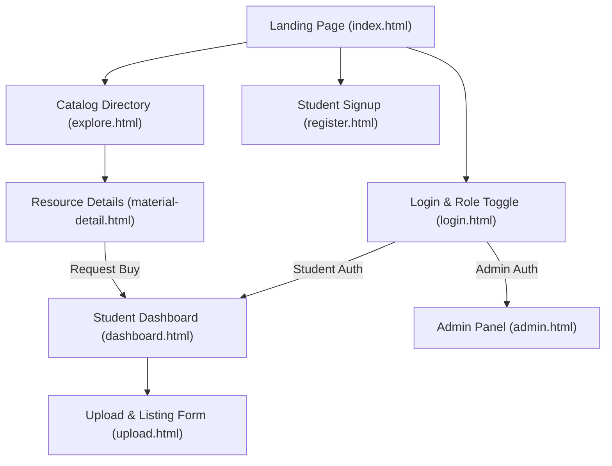

# BookBridge - UI/UX Design & Frontend Specification Document
**Project:** BookBridge - Academic Resource Sharing & Physical Book Exchange Platform  
**Responsible Team Member:** Member 1 (UI/UX Design, HTML, CSS)  
**Academic Module:** Object-Oriented Programming (Java & Web Technologies)  

---

## 1. Executive Summary & Design Vision

BookBridge is a centralized academic sharing platform designed specifically for college students. The frontend interface bridges two distinct user flows:
1. **Digital Academic Materials:** Instant discovery, search, preview, and free download of lecture notes, previous years' question papers (PYQs), and laboratory manuals.
2. **Physical Textbook Exchange:** A peer-to-peer campus marketplace where students can list used textbooks and arrange physical cash handovers directly on campus grounds without complex payment gateways.

As **Member 1**, the primary objective was to deliver a responsive, accessible, modular, and semantically sound frontend layout with reusable CSS components and clean HTML hooks tailored for **Member 2 (JavaScript & Java OOP)** and **Member 3 (Spring Boot & MySQL)**.

---

## 2. Design System & Design Tokens

### 2.1 Color Palette

The color system communicates trust, academic credibility, clarity, and safety for direct campus transactions:

| Role | Variable | Hex Code | Usage |
| :--- | :--- | :--- | :--- |
| **Primary Brand** | `--primary` | `#1E3A8A` | Main navigation headers, primary buttons, branding |
| **Primary Hover** | `--primary-hover`| `#172554` | Interactive state for primary actions |
| **Secondary Accent**| `--secondary` | `#0D9488` | Handover requests, active book exchange actions |
| **Warm Accent** | `--accent` | `#F59E0B` | Book pricing callouts, review highlights |
| **Success State** | `--success` | `#10B981` | "Free" badges, "Available" status, completed handovers |
| **Warning State** | `--warning` | `#F59E0B` | "Pending Review", "Waiting Seller Confirmation" |
| **Danger State** | `--danger` | `#EF4444` | "Sold Out", item deletion, ban user actions |
| **Background Main**| `--bg-main` | `#F8FAFC` | Clean neutral light slate for readability |
| **Card Background**| `--bg-card` | `#FFFFFF` | Surface layer for cards, forms, modals |

### 2.2 Typography Hierarchy

- **Font Family:** `Inter`, system-ui, -apple-system, sans-serif
- **Headings:**
  - `h1`: `2.25rem` – `3.00rem`, Bold 800, line-height 1.2
  - `h2`: `1.85rem` – `2.00rem`, Semi-bold 700, line-height 1.3
  - `h3`: `1.15rem` – `1.25rem`, Medium 600, line-height 1.4
- **Body:** `1.00rem` (16px), regular 400, line-height 1.6
- **Captions & Meta:** `0.75rem` – `0.875rem` (12px–14px), 500

### 2.3 Responsive Breakpoints

1. **Desktop / Wide Screen:** `> 992px` (Full dual-column filters, multi-column grids)
2. **Tablet Screen:** `768px – 992px` (Single column filters with collapsible panels)
3. **Mobile Screen:** `< 768px` (Full-width stacked cards, touch-friendly tap targets of 44px+)

---

## 3. Site Architecture & Wireframe Map

---

## 4. UI Page Catalog & Feature Inventory

### 4.1 Home / Landing Page (`index.html`)
- **Brand Hero Header:** Concise value proposition highlighting campus resource sharing.
- **Unified Search Bar:** Single-input search box with dropdown filter for Digital vs. Physical items.
- **Category Shortcuts:** Direct links into Lecture Notes, PYQs, Physical Textbooks, and Lab Manuals.
- **Live Material Cards:** Visual distinction between free digital resources and priced physical books.
- **3-Step Campus Workflow Visual:** Clear onboarding explaining direct cash handover.

### 4.2 Resource Directory & Search (`explore.html`)
- **Filter Sidebar:**
  - Resource type checkboxes (Digital vs. Physical)
  - Academic department selector (CSE, IT, ECE, MECH, CIVIL)
  - Semester buttons (S1 through S8)
  - Price filter (All, Free ₹0, Under ₹500)
  - Condition filter (New, Like New, Good, Fair)
- **Results Viewport:** Dynamic card grid with sort controls (Recent, Price, Downloads).

### 4.3 Material & Book Details (`material-detail.html`)
- **Dual Flow Logic:**
  - **Digital Items:** Direct PDF download button + file metadata (format, size, upload date).
  - **Physical Books:** Condition rating, cash pricing badge, campus meetup location note, and "Request Handover" trigger.
- **Handover Modal:** Clean overlay dialog allowing students to propose campus meeting spots (Library, Cafeteria, Department Lobby).

### 4.4 Upload & Listing Portal (`upload.html`)
- **Tabbed Switcher:** Seamlessly switches between the `DigitalMaterial` form and `PhysicalMaterial` form.
- **Drag-and-Drop Dropzone:** Intuitive upload zone for study materials.
- **Form Controls:** Complete fieldset matching backend entity parameters (`title`, `subject`, `condition`, `price`, `department`, `semester`).

### 4.5 Student Dashboard (`dashboard.html`)
- **Overview Metrics:** Total uploads, incoming requests, sent requests, and saved library count.
- **Interactive Tabs:**
  - `Incoming Book Requests`: Manage requests from peers with "Accept" and "Mark Cash Received" triggers.
  - `My Sent Requests`: Track status of books requested from seniors/peers.
  - `Active Listings`: Manage item availability.
  - `Saved Library`: Quick bookmark access.

### 4.6 Administrator Portal (`admin.html`)
- **Platform Analytics:** Counters for active students, total digital notes, physical listings, and handovers.
- **Moderation Tools:** Student suspension toggle, material flag/approve/remove tables, and transaction audit log.

### 4.7 Authentication Suite (`login.html` & `register.html`)
- **Role Switcher:** Toggle between Student and Administrator login views.
- **Registration Form:** Validates student ID, department, semester, and contact credentials.

---

## 5. Team Integration Guidelines

### For Member 2 (JavaScript & Java OOP)
- All interactive triggers have clear element IDs (`tabDigitalBtn`, `tabPhysicalBtn`, `purchaseModal`, `openRequestModalBtn`, `clearFiltersBtn`, `sortSelect`).
- Data attributes can be attached to `.material-card` items (`data-category`, `data-dept`, `data-sem`, `data-price`).
- Form submissions are currently wired with sample validation handlers that can be substituted with AJAX/Fetch calls to the Java controllers.

### For Member 3 (Spring Boot & MySQL)
- Form input `name` attributes directly correspond to the entity model variables:
  - `title`, `author`, `isbn`, `condition`, `price`, `status`, `subject`, `department`, `semester`.
- The HTML files can either be served as static assets under `/src/main/resources/static/` or migrated into Thymeleaf templates under `/src/main/resources/templates/` with `th:each`, `th:text`, and `th:action` tags.

---

## 6. Deliverable Checklist (Member 1)

- [x] Full UI/UX Design System (`css/style.css`)
- [x] Reusable Component Library (`css/components.css`)
- [x] Responsive Landing Page (`index.html`)
- [x] Directory & Filtering Catalog (`explore.html`)
- [x] Detailed Resource View & Handover Modal (`material-detail.html`)
- [x] Dual-Type Resource Upload Portal (`upload.html`)
- [x] Student Management Dashboard (`dashboard.html`)
- [x] Administrator Moderation Panel (`admin.html`)
- [x] Sign-In & Sign-Up Auth Views (`login.html`, `register.html`)
- [x] Comprehensive UI/UX Design Specification (`docs/UI_UX_DESIGN_SPECIFICATION.md`)
